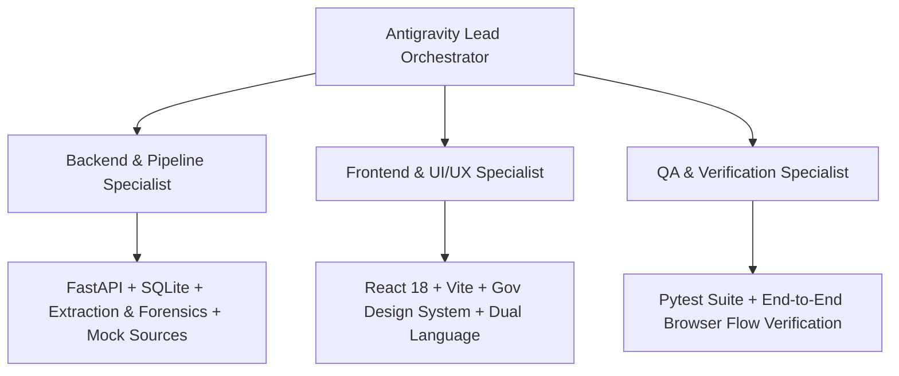

# PRAMAAN - Project Task Plan & Multi-Agent Execution Blueprint
**Problem Statement 26261 (SIH 2026) · Regulation Bureau, AICTE**  
*System: Application Validation & Document Verification System for AICTE*

---

## 1. Executive Summary & Boundaries

### 1.1 Objective
Build a production-grade, highly reliable, government-standard web prototype named **Pramaan** to assist AICTE officers in pre-checking Extension of Approval (EoA) applications prior to formal scrutiny.

### 1.2 Core Operating Principles
- **AI Assists, Officers Decide**: Automated processing generates evidence, confidence scores, and structured flags. Officers make all adjudication choices.
- **Source of Truth**: The submitted `specification.md` (`AICTE-Pramaan-Spec.md`) is the absolute specification.
- **Synthetic & Privacy Compliant**: 100% synthetic institutional datasets and mocked external authority APIs. No real student or institution PII.
- **Strict Scope Boundaries**:
  - In Scope: 4 user roles, 5 core screens, document extraction (OCR/PDF/Image), 5 forensic anomaly checks, 4 mocked issuing sources returning all 6 exact statuses, infrastructure advisory analysis, configurable handbook rules, immutable audit logging with CSV export, bilingual support (EN/हिं), and 15 planted seed applications with sample files.
  - Out of Scope: Live DigiLocker/NAD production API keys, production payment gateways, final legal approval signing, mobile native app, real on-site physical inspector dispatch.

---

## 2. Multi-Agent Development Structure

To ensure compartmentalized, robust implementation without cross-domain regression, autonomous development will be orchestrated through specialized roles:

### Agent Roles & Ownership:
1. **Antigravity Lead Orchestrator**: Enforces project boundaries, coordinates handoffs between backend, frontend, and testing, and maintains state consistency.
2. **Backend & Pipeline Specialist**:
   - SQLite schema & SQLAlchemy/SQLModel data layer.
   - FastAPI REST endpoints with JWT authentication and RBAC.
   - Document processor (PyMuPDF parser, OpenCV/PIL image checks, ELA detector, fallback OCR text extractor).
   - Mock verification engines (University Portal, NBA/NAAC, State Land Authority, Fire Dept).
   - Forensic rules engine (`rules/*.json`) with APH handbook citations.
   - Immutable audit trail and CSV exporter.
   - Synthetic seed generator (15 planted test applications + sample PDFs/images).
3. **Frontend & UI/UX Specialist**:
   - React + Vite SPA with Tailwind CSS styled strictly to AICTE/NIC Gov portal guidelines.
   - Tricolour header strip, logo, bilingual dictionary toggle (English & Hindi).
   - 5 primary screens: Login, Dashboard with metrics & alerts, Applications List with multi-filter, Application Detail (with 7 sub-tabs and Officer Action side panel), and Audit Log.
   - Configurable Rules management page and "About / Safeguards" page.
4. **QA & Verification Specialist**:
   - Backend automated test suite (pytest) covering authentication, OCR pipeline, mock verifications, anomaly flags, and audit logs.
   - Browser verification script executing the full 3-minute SIH demo flow end-to-end.

---

## 3. Assumptions & Environmental Constraints

1. **Host OS & Runtimes**:
   - OS: Windows 11.
   - Python: 3.13.5 (installed and active).
   - Node: v22.17.1 with npm 10.9.2 (executed via `npm.cmd` due to Windows PowerShell script execution policy).
2. **OCR & Native Binaries**:
   - Tesseract binary is not pre-installed on the host system PATH.
   - *Design Choice*: The backend document extraction pipeline will feature a **Dual-Engine Architecture**:
     - Engine A: Direct high-fidelity PDF stream & vector/text/metadata parser via `PyMuPDF` (`fitz`), plus PIL/OpenCV for image analysis and visual edit (ELA) detection.
     - Engine B: Fallback OCR heuristic text synthesizer & structured field matcher that seamlessly handles image uploads and scanned documents without crashing if `tesseract` binary is missing, while connecting to `pytesseract` if configured.
3. **Security & Cryptography**:
   - Passwords hashed using standard PBKDF2/bcrypt.
   - Mocked encryption for uploaded files stored in secure server directory.
4. **Bilingual Requirement**:
   - Client-side i18n dictionary supporting English and Hindi (Devanagari script) across all core navigation, status tags, checklist badges, and action buttons.

---

## 4. Phase-by-Phase Implementation Roadmap

### Phase 1: Environment Setup & Data Foundation
- **1.1 Directory Structure Initialization**:
  - `backend/`: FastAPI app, database models, services, rules, seed data.
  - `frontend/`: Vite + React project, Tailwind CSS, component hierarchy, i18n strings.
  - `sample_data/`: 6 generated sample PDFs and 4 sample inspection images reflecting planted forensic cases.
- **1.2 Database Models & SQLite Setup**:
  - Tables: `institutes`, `applications`, `documents`, `verifications`, `flags`, `audit_log`, `rules`.
- **1.3 Rules & Handbook JSON Configuration**:
  - Initializing `backend/rules/eoa_rules.json` with APH 2026-27 references.
- **1.4 Seed Data Ingestion**:
  - Generating 15 synthetic applications covering all required categories and planted anomalies.

### Phase 2: Backend Core Services & Mock Engines
- **2.1 Authentication & RBAC**:
  - JWT generation and role validation for Institution, Scrutiny Officer, Senior Officer, and Auditor.
- **2.2 Document Extraction & Forensic Engine**:
  - Metadata inspection (creation date, modification date, editing tool tags).
  - Anomaly flags generation (duplicate hash, date irregularity, visual edit ELA, ID mismatch).
- **2.3 Mock External Verification Gateways**:
  - University Portal, NBA/NAAC, State Land Authority, Fire Dept.
  - Implementation of all 6 exact statuses: `Verified`, `Mismatch Detected`, `Expired`, `Verification Pending`, `Source Unavailable`, `Manual Review Required`.
- **2.4 Infrastructure Evaluator**:
  - Computes area per student, lab count sufficiency, image blurriness, advisory verdict (*Sufficient*, *Needs More Evidence*, *Suggest Inspection*).
- **2.5 Audit Log & CSV Export**:
  - Append-only audit logger triggered by all pipeline events and officer decisions.

### Phase 3: Frontend Government-Portal UI/UX
- **3.1 Design System & Theme Alignment**:
  - Navy `#1B3A6B`, Saffron `#E8890C`, Green `#1E7B34`, Amber `#B7791F`, Red `#B3261E`.
  - Top tricolour strip, plain 1px borders, 4px rounded corners, zero decorative gradients.
- **3.2 Navigation & Header**:
  - Tricolour strip, Pramaan logo badge, English/Hindi language switcher, User profile/Role indicator.
  - Sidebar: Dashboard, Applications, Verification Engine, Audit Trail, Handbook Rules, About/Safeguards.
- **3.3 Screens Implementation**:
  - **Login**: Instant one-click demo login selector for all 4 roles.
  - **Dashboard**: 5 metric counters, "Needs your attention" urgent alerts, deficiency category bar chart, prototype statistics.
  - **Applications List**: Dynamic search, status/category filter, paginated data grid.
  - **Application Detail**:
    - Summary Tab with Institute profile and Officer remarks.
    - Checklist Tab with live status icons (✔ / ✖ / Expired).
    - Documents Tab with file preview, OCR text drawer, extracted fields.
    - Verification Tab with mock source call buttons, response payload, timestamps.
    - Flags Tab with What/Where/Why/Confidence and "Preliminary indicator" warning.
    - Infrastructure Tab with photo inspection, advisory tags.
    - History Tab with chronological event trail.
    - Fixed Right-side Officer Action Drawer: Accept Finding, Dismiss, Request Clarification.
  - **Audit Log**: Searchable, filterable audit event table with CSV download.
  - **Handbook Rules & Safeguards**: Rule toggle interface with handbook clauses and system ethics statement.

### Phase 4: Integration, Verification & Demonstration Flow
- **4.1 API & Frontend Integration**:
  - End-to-end API communication between React and FastAPI.
- **4.2 Automated Testing Execution**:
  - Pytest suite covering backend routes, edge cases, and role restrictions.
- **4.3 Demo Verification Walkthrough**:
  - Automated or scripted validation of the 3-minute presentation script specified in Section 10 of the brief.

---

## 5. Verification & Acceptance Criteria Matrix

| Feature | Verification Method | Pass Criteria |
|---|---|---|
| Role-based Login | Automated API test & Browser check | All 4 roles login with appropriate privileges |
| Document OCR & Parsing | Unit test on sample PDF & Image | Extracted fields (name, dates, ID) appear in UI |
| Category Checklist | Unit test | Correct checklist loads per category with dynamic checks |
| 4 Mock Verification Sources | API test suite | Returns all 6 statuses: `Verified`, `Mismatch Detected`, `Expired`, `Verification Pending`, `Source Unavailable`, `Manual Review Required` |
| Forensic Anomaly Flags | Pipeline unit test | Flags include What, Where, Why, Confidence, and mandatory disclaimer |
| Officer Decision Flow | Browser test | Officer can Accept, Dismiss, or Request Clarification with audit trail update |
| Audit Trail CSV | Export test | CSV downloads properly with immutable records |
| Hindi Localization | UI component check | Header toggle switches labels between English and Hindi |
| Government Design System | CSS/Visual audit | Strict adherence to color codes, 1px borders, no shadows/emojis |
